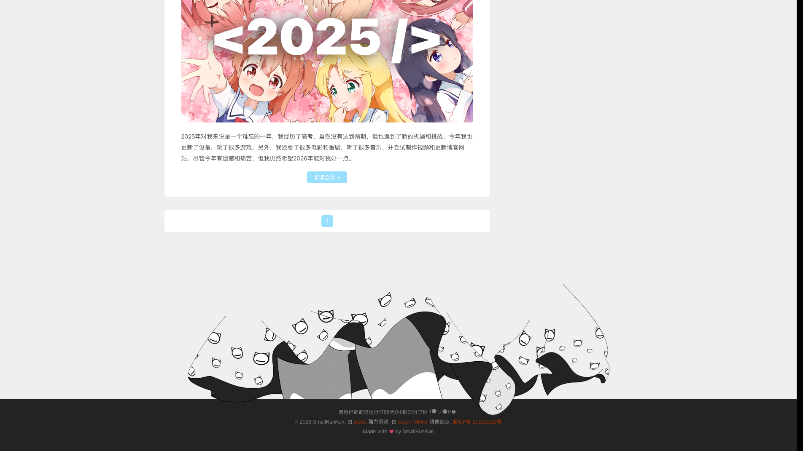
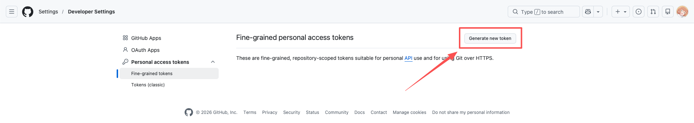
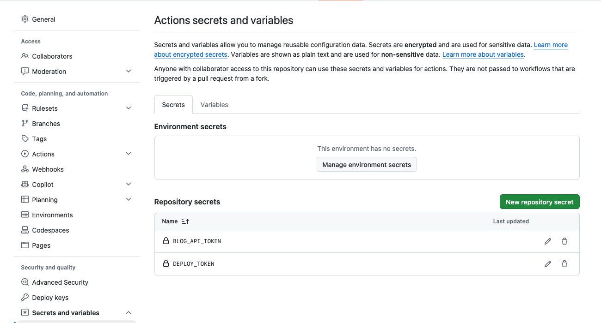
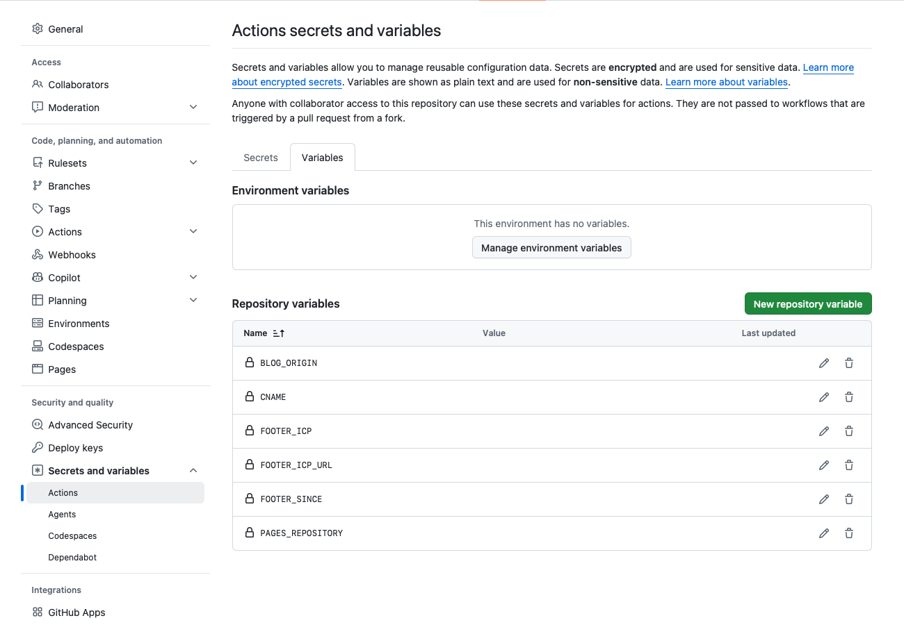
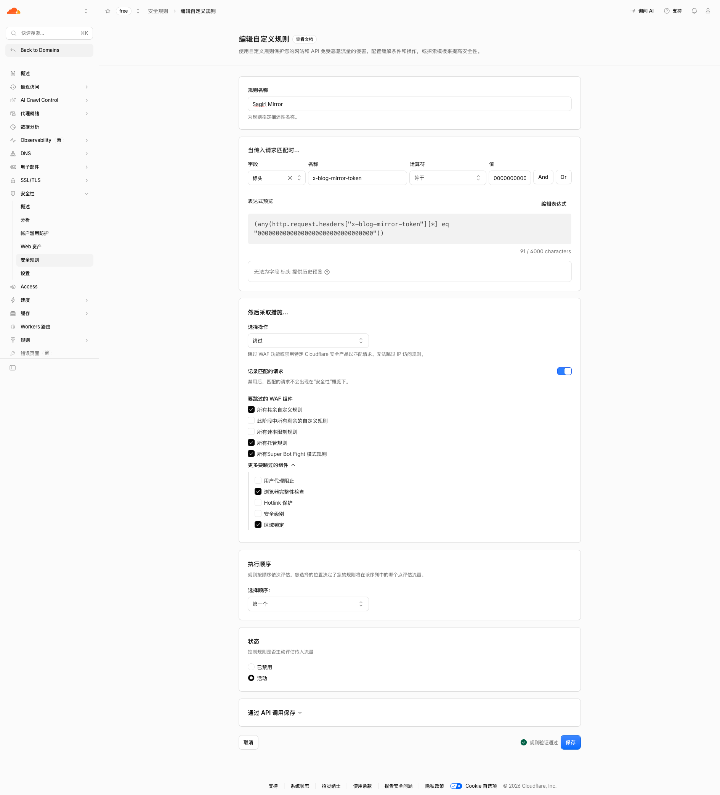

<div align="center">

# Sagiri Mirror

**A static, read-only mirror of Flare Stack Blog with the Sagiri theme.**

Build-time content fetching · Astro + Vue islands · No backend at runtime

[](https://astro.build)
[](https://vuejs.org)
[](https://www.typescriptlang.org)
[](https://pages.github.com)
[](./LICENSE)

[演示站点](https://kunkun.js.org) · [功能特性](#-功能特性) · [快速开始](#-快速开始) · [配置](#-配置)

</div>

---

## 📖 简介

Sagiri Mirror 将 [Flare Stack Blog](https://github.com/du2333/flare-stack-blog) 的内容构建成静态站点，并使用 Astro + Vue islands 复刻 Sagiri 主题的版式与交互。站点配置、文章、友链和图片都在构建阶段读取，产物可直接部署到 GitHub Pages。

运行时没有数据库、服务端或博客 API 请求。文章发布、评论、后台管理和浏览量统计仍由源站负责，镜像站只承担公开阅读。

## 📷 展示

<div align="center">
  
  
</div>

## ✨ 功能特性

**界面与交互**

- 复刻 Sagiri / Pisces 的 banner、文章卡片、侧栏、页脚插画和背景缎带。
- 内置自动、浅色、深色三种主题模式，自动模式跟随系统，选择保存在本地。
- 文章页提供目录、阅读时长、上一篇 / 下一篇和图片放大预览。
- 桌面端与移动端分别适配；非文章页避免自动进入浏览器阅读模式。

**内容与构建**

- 构建时从远端 API 读取站点配置、文章、分类、标签和友链。
- 生成静态搜索索引，支持标题、摘要、分类、标签和正文检索。
- 构建时将头像、banner、图标、封面、正文图片和友链头像下载到本地。
- GitHub Actions 自动构建并推送，支持 push、手动触发和每日定时同步。
- 不依赖后端运行时，适合部署到 GitHub Pages 或任意静态托管平台。

## 🧭 工作原理

```text
Flare Stack Blog API
  ├─ /api/site/config
  ├─ /api/posts
  ├─ /api/friend-links
  └─ /feed.json
        │
        ▼
Astro build
  ├─ generate HTML / CSS
  └─ download remote images to dist/images/remote
        │
        ▼
dist/ ──► gh-pages ──► GitHub Pages
```

所有内容请求都发生在构建阶段。接口不可用或 `BLOG_ORIGIN` 未配置时，构建会直接失败，不会生成占位数据。

## 🚀 快速开始

Sagiri Mirror 将构建和发布分开：

- `sagiri-mirror` 负责构建静态文件。
- 构建产物推送到目标用户站点仓库的 `gh-pages` 分支。
- 目标仓库的 GitHub Pages 负责最终访问。

### 前置条件

| 依赖 | 要求 |
| :--- | :--- |
| GitHub | 一个可创建仓库和 Actions 的账号 |
| Cloudflare | 已部署 Flare Stack Blog，并可修改域名安全规则 |
| 目标仓库 | 建议使用 `<username>.github.io` |

### 1. Fork 仓库

打开本项目仓库，点击右上角的 **Fork**。在 **Create a new fork** 页面中选择自己的账号，保留仓库名和描述，勾选 **Copy the main branch only** 后创建。

### 2. 准备目标仓库

创建一个名为：

```text
<username>.github.io
```

的仓库，并创建 `gh-pages` 分支。

在 **Settings → Pages** 中设置：

- **Source**：`Deploy from a branch`
- **Branch**：`gh-pages`
- **Directory**：`/ (root)`

> [!IMPORTANT]
> `sagiri-mirror` 仓库本身不需要开启 Pages。若之前开启过，请在 **Settings → Pages** 中 **Unpublish site**，否则每次 push 都会触发 GitHub 的 Jekyll 构建并尝试解析 `src/pages/*.astro`。

> [!IMPORTANT]
> 部署会覆盖目标仓库 `gh-pages` 分支的文件。首次部署前请确认其中没有需要保留的源码。

### 3. 创建部署 PAT

打开 **GitHub Settings → Developer settings → Personal access tokens → Fine-grained tokens**，点击 **Generate new token**。



在创建页面中填写：

| 字段 | 值 |
| :--- | :--- |
| Token name | 任意名称 |
| Resource owner | 自己的 GitHub 账号 |
| Expiration | 按需选择 |
| Repository access | **Only select repositories** |
| Repositories | 目标用户站点仓库，例如 `your-name/your-name.github.io` |
| Permissions | **Contents: Read and write** |

> [!IMPORTANT]
> `DEPLOY_TOKEN` 只用于推送目标仓库，因此 PAT 必须授权目标用户站点仓库，而不是 `sagiri-mirror`。

生成后保存以 `github_pat_` 开头的字符串。该值只显示一次。

### 4. 配置 Secrets 与 Variables

回到 `sagiri-mirror` 仓库，打开 **Settings → Secrets and variables → Actions**。

#### Secrets

| Name | Value |
| :--- | :--- |
| `DEPLOY_TOKEN` | 上一步生成的 PAT |
| `BLOG_API_TOKEN` | 运行 `openssl rand -hex 32` 生成的字符串 |

`openssl rand -hex 32` 生成 64 位十六进制字符串，后面配置 Cloudflare 安全规则时还要使用同一个值。



#### Variables

| Name | Required | Description | Example |
| :--- | :---: | :--- | :--- |
| `BLOG_ORIGIN` | Yes | Flare Stack Blog 地址 | `https://your-blog.example.com` |
| `PAGES_REPOSITORY` | Yes | 目标用户站点仓库 | `your-name/your-name.github.io` |
| `CNAME` | No | 自定义域名 | `blog.example.com` |
| `FOOTER_SINCE` | No | 博客开始运行时间 | `2020-01-01T00:00:00+08:00` |
| `FOOTER_ICP` | No | ICP 备案号 | `萌ICP备 00000000号` |
| `FOOTER_ICP_URL` | No | ICP 查询链接 | `https://beian.miit.gov.cn/` |



`BLOG_ORIGIN` 和 `PAGES_REPOSITORY` 为必填项。`CNAME` 留空时部署到目标仓库的默认地址；设置后会生成 `dist/CNAME`，并将站点部署到该域名根路径。

### 5. 配置 Cloudflare 安全规则

打开 Cloudflare 控制台，进入 Flare Stack Blog 使用的域名，打开 **安全性 → 安全规则**，创建自定义规则：

| 字段 | 值 |
| :--- | :--- |
| 规则名称 | `Sagiri Mirror` |
| 字段 | 请求头 / 标头 |
| 名称 | `x-blog-mirror-token` |
| 运算符 | 等于 |
| 值 | `BLOG_API_TOKEN` |
| 操作 | 跳过 |

跳过以下组件：

```text
所有其余自定义规则
所有托管规则
所有 Super Bot Fight 模式规则
浏览器完整性检查
区域锁定
```

不要勾选“此阶段中所有剩余的自定义规则”。选择顺序设为 **第一个**，状态设为 **活动**，保存并部署。

参考配置：



> [!IMPORTANT]
> Cloudflare 免费版的 Bot Fight Mode 不受 WAF 跳过规则控制。若安全事件显示 `bot_fight_mode` 正在 challenge，需要在 **安全性 → 设置** 中关闭 Bot Fight Mode，或升级到支持 Super Bot Fight Mode 的方案。

### 6. 运行部署

在 `sagiri-mirror` 仓库打开 **Actions → Sync and deploy → Run workflow**，再次点击 **Run workflow**。

等待工作流完成。首次部署成功后，可通过自定义域名或：

```text
https://your-name.github.io/
```

访问站点。

### 自动同步

工作流在以下时机运行：

- push 到 `main`
- 每天北京时间 04:00
- 手动执行 `workflow_dispatch`

定时任务使用 UTC：

```text
0 20 * * * UTC = 04:00 Asia/Shanghai
```

GitHub 的定时任务可能延迟数分钟。

## 🔧 配置

### Actions Variables

| Name | Required | Description |
| :--- | :---: | :--- |
| `BLOG_ORIGIN` | Yes | 源站地址，覆盖 `blogSource.origin` |
| `PAGES_REPOSITORY` | Yes | 构建产物推送的目标仓库 |
| `CNAME` | No | 自定义域名，写入 `dist/CNAME` 并设置 `base=/` |
| `FOOTER_SINCE` | No | 页脚运行时间，留空不显示 |
| `FOOTER_ICP` | No | 页脚 ICP 备案号，留空不显示 |
| `FOOTER_ICP_URL` | No | ICP 查询链接 |

### Actions Secrets

| Name | Required | Description |
| :--- | :---: | :--- |
| `DEPLOY_TOKEN` | Yes | 对目标用户站点仓库有 Contents 写权限的 PAT |
| `BLOG_API_TOKEN` | Yes | 读取源站 API、下载图片和通过 WAF 的请求头 token |

### 本地配置

`src/blog.config.ts` 中的 `blogSource.origin` 可作为本地默认源站地址，`footerDefaults` 可作为页脚默认值。环境变量和 Actions Variables 优先级更高。

站点标题、作者、tagline、头像、banner、图标和社交链接来自远端 `/api/site/config`，不在本地硬编码。

## 💻 本地开发

### 环境要求

- Node.js >= 22.23.4
- npm

### 启动开发服务器

```bash
export BLOG_ORIGIN=https://your-blog.example.com
npm install
npm run dev
```

默认访问 `http://localhost:4321`。

### 构建与预览

```bash
BLOG_ORIGIN=https://your-blog.example.com npm run build
npm run preview
```

构建产物输出到 `dist/`。图片本地化会访问远端图片地址；需要时同时设置 `BLOG_API_TOKEN`。

### 常用命令

| Command | Description |
| :--- | :--- |
| `npm run dev` | 启动开发服务器 |
| `npm run build` | 构建静态站点并本地化远端图片 |
| `npm run preview` | 预览 `dist/` |

## 📁 项目结构

```text
.
├── .github/workflows/deploy.yml   # 构建并同步到目标仓库
├── docs/assets/quick-start/       # 快速开始截图
├── docs/assets/showcase/          # README 展示截图
├── public/                        # 字体、鼠标指针、页脚插画等静态资源
├── scripts/
│   └── localize-images.mjs        # 构建后下载并本地化远端图片
├── src/
│   ├── blog.config.ts             # 源站地址与页脚配置
│   ├── components/                # 页面组件与 Vue 搜索岛
│   ├── data/                      # 远端 API、文章、搜索索引
│   ├── scripts/cursor-effects.ts  # 点击粒子效果
│   ├── layouts/BaseLayout.astro   # 全站布局与图片预览
│   ├── pages/                     # 首页、文章、分类、标签、友链、搜索
│   ├── styles/global.css          # Sagiri 风格样式
│   └── utils/url.ts               # GitHub Pages 子路径处理
├── astro.config.mjs               # Astro 配置
├── LICENSE
└── package.json
```

## 🙏 致谢

- **[flare-stack-blog](https://github.com/du2333/flare-stack-blog)**：博客后端、内容模型与 API。
- **[hexo-theme-sagiri](https://github.com/DIYgod/hexo-theme-sagiri)**：Sagiri 主题的视觉与交互参考。
- **[Astro](https://astro.build)**、**[Vue](https://vuejs.org)**、**[medium-zoom](https://github.com/francoischalifour/medium-zoom)**：本项目使用的开源框架与库。

## 📄 许可

本项目采用 MIT License，详见 [LICENSE](./LICENSE)。

上游项目许可：

- `flare-stack-blog` 采用 GPL-3.0。
- `hexo-theme-sagiri` 采用 MIT。
